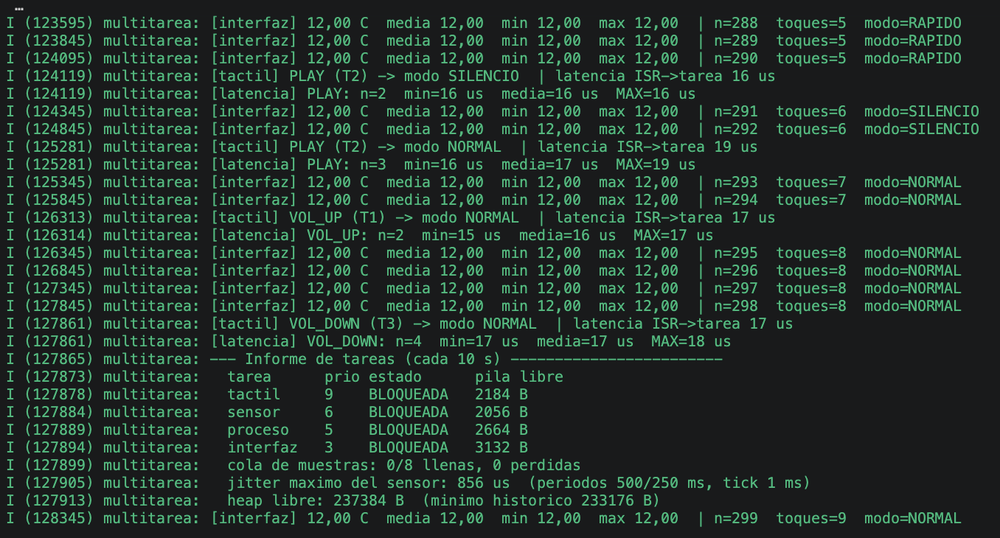
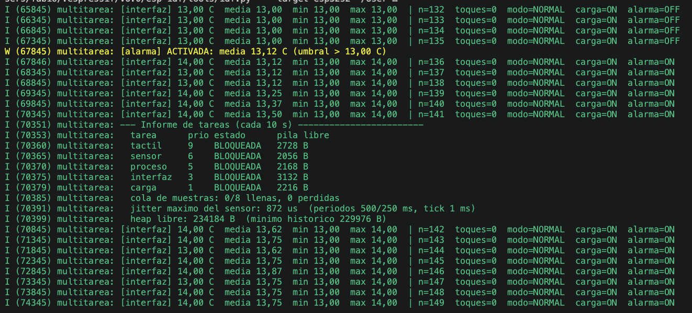
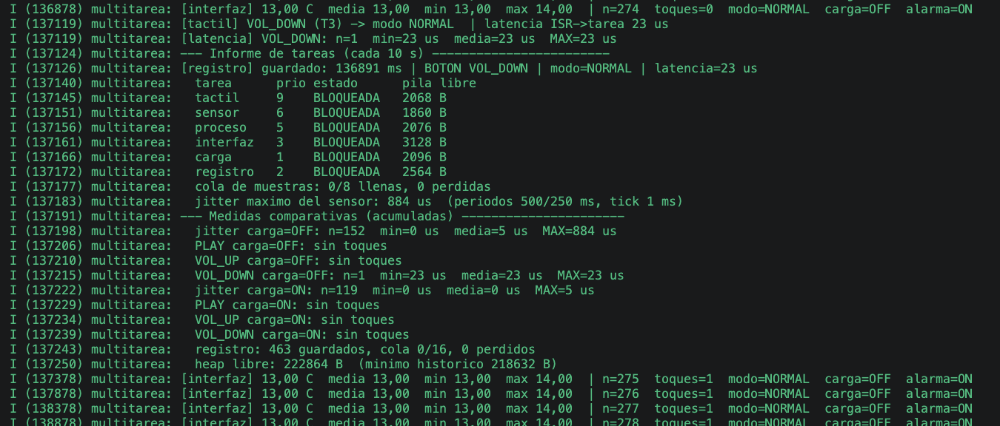
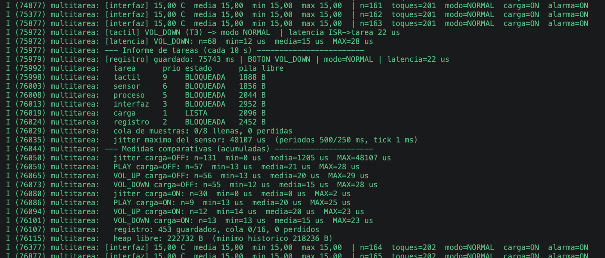

# App 4 - Control de Flujo ESP32-S2 Kaluga-1

La idea del ejercicio es modificar el ejemplo `multitarea` para controlar la temperatura interna de la ESP32-S2.

El programa puede generar carga de CPU para aumentar la temperatura, activar una alarma y guardar los eventos. También permite comparar los tiempos de respuesta con la carga apagada y encendida.

El sensor mide la temperatura del chip, no la temperatura ambiente.

## Botones

| Botón | Canal | Acción |
|---|---|---|
| PLAY | T2 | Cambiar entre NORMAL, RAPIDO y SILENCIO |
| VOL_UP | T1 | Reiniciar mínimo y máximo |
| VOL_DOWN | T3 | Mostrar el informe de tareas |

En el ejemplo original VOL_DOWN estaba configurado en T4. Durante las pruebas lo cambié a T3 para que funcionara.



## Tareas

El programa utiliza seis tareas de FreeRTOS. Las prioridades se eligieron para que los botones y el sensor puedan atenderse antes que las tareas menos urgentes.

| Tarea | Prioridad | Función y motivo |
|---|---:|---|
| tactil | 9 | Atender los botones rápidamente |
| sensor | 6 | Leer la temperatura cada 500 ms (250 ms en RAPIDO) |
| proceso | 5 | Calcular la media, mínimo, máximo y alarma |
| interfaz | 3 | Mostrar el panel y actualizar el LED; puede esperar |
| registro | 2 | Guardar eventos en flash sin frenar al sensor |
| carga | 1 | Hacer cálculos de fondo sin retrasar las otras tareas |

Se utilizan **colas** para pasar muestras, toques y eventos entre tareas. El **mutex** protege el estado compartido. El **semáforo binario** indica que la interfaz está lista para iniciar el sensor, y una **notificación** avisa a la interfaz cuando hay una nueva muestra procesada. El **temporizador software** muestra el informe cada 10 segundos.

## Carga térmica y alarma

La tarea `carga` alterna automáticamente entre 60 segundos apagada y 60 segundos encendida. Cuando está encendida realiza cálculos para hacer trabajar a la CPU.

Configuré el umbral de prueba en **13 °C**, ya que el sensor de mi placa mostraba valores cercanos a esa temperatura. La alarma se activa cuando la media supera los 13 °C y se apaga al bajar a 12,50 °C.

Durante la prueba apareció:

```text
[alarma] ACTIVADA: media 13,12 C (umbral > 13,00 C)
```



## Registro de eventos

Se guardan los eventos de los botones, la carga y la alarma en la memoria flash mediante NVS. El programa conserva los últimos 32 eventos y puede recuperarlos después de reiniciar la placa.

En las pruebas el informe mostró **0 eventos perdidos** y también **0 muestras de temperatura perdidas**. La cola de muestras tiene capacidad para 8 elementos; cuando se llena, el programa cuenta las pérdidas en lugar de retrasar al sensor.

## Mediciones

Para medir el jitter dejé la placa en modo NORMAL sin tocar los botones durante las fases con y sin carga.

| Jitter del sensor | Carga OFF | Carga ON |
|---|---:|---:|
| Intervalos medidos | 152 | 119 |
| Media | 5 µs | 0 µs* |
| Máximo | 884 µs | 5 µs |

*La media de 0 µs aparece redondeada en la consola. El programa mide la variación del intervalo entre lecturas respecto a los 500 ms esperados.*



También medí la latencia entre la interrupción del botón y la tarea que lo atiende. Estos resultados son de otra prueba, pulsando los botones durante ambas fases:

| Botón | OFF: muestras / máximo | ON: muestras / máximo |
|---|---|---|
| PLAY | 57 / 28 µs | 9 / 25 µs |
| VOL_UP | 56 / 29 µs | 12 / 23 µs |
| VOL_DOWN | 55 / 28 µs | 13 / 23 µs |



En estas pruebas el jitter no aumentó con la carga encendida y las latencias máximas de los botones fueron menores a 30 µs. Las secciones protegidas por el mutex son cortas y el informe de tareas permite ver la pila libre de cada una.

## Conclusión

Se pudo transformar el termómetro original en un vigilante térmico que genera carga, avisa cuando la media supera el umbral y guarda eventos en flash.

Además, pude comprobar las prioridades de las tareas con mediciones reales. En las pruebas realizadas, el sensor y los botones siguieron respondiendo con la carga encendida.
